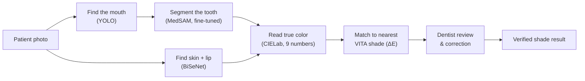
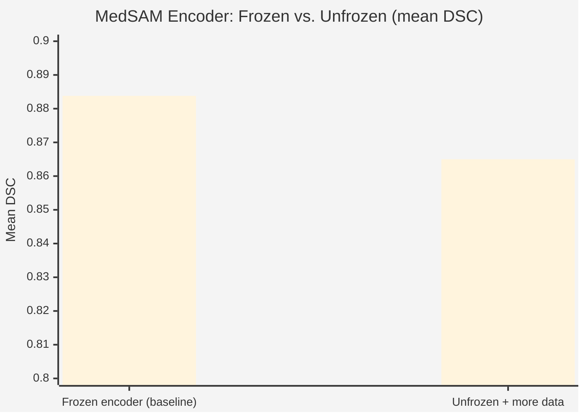

# veneer-ai-shade-match

**Predicting VITA dental shade from a single intraoral photo — segment the tooth, read its true color, match it against the clinical shade guide, with a dentist verifying every step.**

Led by **Dr. Sanskriti Patil** (KLE VK Institute of Dental Sciences, Belagavi) · Built by **Hemant Darur**

---

## The problem

Dentists match a patient's tooth color to one of 16 standard VITA shades (A1, A2, B1...D4) by eye, under whatever lighting happens to be in the room. That's inherently inconsistent — even between trained professionals — and it directly affects how well a veneer or restoration ends up matching the patient's real teeth.

This project removes the human-eye step from the *measurement*, while keeping a human dentist in charge of *verifying* every result.

## How it works



1. **Localize** — a small YOLO detector finds the mouth region in the photo, giving a box prompt.
2. **Segment the tooth** — MedSAM (Meta's Segment Anything, fine-tuned on dental photos) outlines the tooth precisely from that box.
3. **Segment skin & lip** — BiSeNet (a face-parsing model) finds the surrounding skin and lip regions in the same photo, when visible.
4. **Extract color** — each region's true color is read in CIELab space (closer to human color perception than RGB), giving 9 numbers: tooth L\*a\*b\*, skin L\*a\*b\*, lip L\*a\*b\*.
5. **Match shade** — the tooth's L\*a\*b\* is compared by color distance (ΔE) against the 16 official VITA reference colors, picking the closest match.
6. **Dentist review** — every tooth outline is checked by a real dentist in a purpose-built web tool before anything is trusted downstream.

## What's actually working today

| Component | Status |
|---|---|
| Tooth localization (YOLO) | Trained, in production use |
| Tooth segmentation (MedSAM, frozen encoder) | Trained — **DSC 0.8838** on held-out data |
| Skin/lip segmentation (BiSeNet) | Integrated, degrades gracefully when a photo doesn't show enough face |
| Color extraction (CIELab, 9-vector) | Working |
| Shade matching (ΔE vs. VITA reference) | Working — zero training required, ready to use today |
| Dentist review web app | Built, AWS deployment documented |
| CLIP-based shade classifier (visual + color fusion) | Designed, training blocked on real dentist-verified labels |

### A real finding worth noting

Unfreezing MedSAM's image encoder to fine-tune on a larger combined dataset looked like an obvious improvement — it wasn't. Mean DSC *dropped* from the frozen-encoder baseline (0.8838) into the high-0.86s with more training, a sign of catastrophic forgetting rather than a ceiling worth pushing past. The frozen-encoder checkpoint stayed the production choice; effort went into fixing localization (YOLO box prompts) instead, which had a clearer, measurable payoff.



## Project structure

```
veneer-shade-ai/
├── module_0_environment/        # environment setup
├── module_1_preprocessing/      # image preprocessing
├── module_1b_gum_lip_suppression/ # pivoted away from — see notes.md
├── module_2_medsam_finetune/    # MedSAM fine-tuning
├── module_2b_yolo_localization/ # YOLO mouth/tooth detector
├── module_2d_eval_combined/     # real-pipeline evaluation (YOLO box, not GT box)
├── module_3_medsam_inference/   # production inference (YOLO box → MedSAM)
├── module_3c_hqsam_zeroshot/    # HQ-SAM zero-shot comparison
├── module_4_bisenet/            # face parsing (skin/lip)
├── module_5_integration/        # full pipeline: photo → 9-number color vector
├── module_6_shade_classification/ # ΔE nearest-shade matching (no training needed)
├── module_6_vit_clip/           # CLIP-based classifier (image + color fusion)
├── doctor_review_app/           # Streamlit web app for dentist review + AWS deploy
└── scripts/
```

Each module has its own `notes.md` explaining *why* it's built the way it is, including the approaches that were tried and dropped.

## The dentist review tool

A Streamlit web app, deployable to any browser (including a tablet), where Dr. Sanskriti reviews every tooth segmentation before it's trusted:

- **✅ Looks good** — approves the mask.
- **📦 Redraw the box** — she draws a box herself; the model reruns segmentation with it, instead of YOLO's guess.
- **✏️ Fix by hand** — a brush tool for direct mask correction.

All review state, images, and approved masks live in Google Drive so nothing is lost between sessions. The app itself deploys to AWS EC2, with a Lambda-backed start/stop button so the instance only runs (and bills) while actually in use — see [`doctor_review_app/deploy/GETTING_STARTED.md`](doctor_review_app/deploy/GETTING_STARTED.md) for the full zero-to-deployed walkthrough.

## Datasets

- **[alielhenidy/tooth-dataset](https://www.kaggle.com/datasets/alielhenidy/tooth-dataset)** ("NCT") — the primary tooth photo + mask dataset. Mostly tight tooth/lip framing, not full-face.
- **SmileImages** — a smaller, supplementary set added specifically for fuller face framing, needed for the skin/lip portion of the color read.

No new patient data has been collected for this project — everything above is previously published, publicly available data.

## Open question

The ΔE shade-matching step can run standalone, no training needed. The more advanced CLIP-based classifier, though, needs real example labels to learn from — and right now it only has its own pseudo-labels (the ΔE step's own confident guesses) to train on, which risks the model just re-learning its own mistakes. Getting real dentist-verified shade labels — Dr. Sanskriti's actual clinical judgment on a sample of photos — is the next concrete step before that model is trained for real.

## Running it

See each module's `notes.md` for Kaggle-notebook-level detail. For the review app specifically:

```bash
cd doctor_review_app
python3 -m pip install -r requirements.txt
streamlit run app.py          # full app — needs Drive + checkpoints configured
streamlit run app_preview.py  # UI-only preview, zero setup, fake data
```

## Credits

Research lead: **Dr. Sanskriti Patil**, KLE VK Institute of Dental Sciences, Belagavi.
Pipeline & engineering: **Hemant Darur**.

Built on MedSAM / Segment Anything (Meta AI), YOLO (Ultralytics), BiSeNet, and the VITA Classical Shade Guide's published reference color values.
